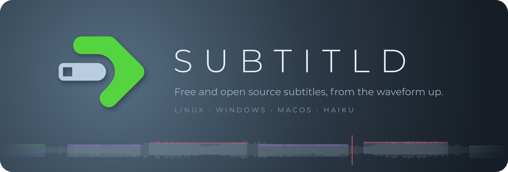
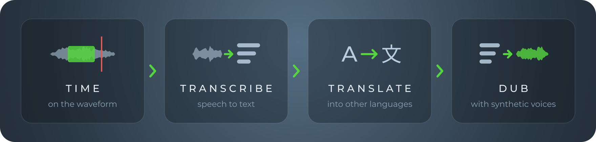
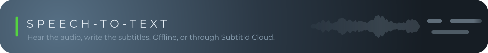

  

  <b>A free and open source subtitle editor for Linux, Windows, macOS and Haiku.</b> 
  Time subtitles on the waveform, then transcribe, translate and dub them, with engines that can run on your own machine.

  <a href="https://subtitld.org">Website</a> ·
  <a href="https://github.com/Subtitld/subtitld/releases/latest">Download</a> ·
  <a href="https://github.com/Subtitld/subtitld">Source</a> ·
  <a href="https://discord.gg/XjZ9AJAgU">Discord</a>

  

## The editor

**[subtitld](https://github.com/Subtitld/subtitld)**: the desktop app (GPL-3.0). Install it from
[Flathub](https://flathub.org/apps/org.subtitld.Subtitld), the [Snap Store](https://snapcraft.io/subtitld),
the [AUR](https://aur.archlinux.org/packages/subtitld), [PyPI](https://pypi.org/project/subtitld/) or the
[releases page](https://github.com/Subtitld/subtitld/releases/latest).

## Add-ons

Speech, translation and voice engines are add-ons, installed from inside Subtitld. Each one lives in its
own repository; the list the app reads is [addons-catalog](https://github.com/Subtitld/addons-catalog).

[whistle](https://github.com/Subtitld/addon-whistle) ·
[whispercpp](https://github.com/Subtitld/addon-whispercpp) ·
[phonon2](https://github.com/Subtitld/addon-phonon2) ·
[vosk](https://github.com/Subtitld/addon-vosk) ·
[realtimestt](https://github.com/Subtitld/addon-realtimestt) ·
[assemblyai](https://github.com/Subtitld/addon-assemblyai) (cloud)

[translate-offline](https://github.com/Subtitld/addon-translate-offline)

[voxcpm](https://github.com/Subtitld/addon-voxcpm) ·
[kokoro](https://github.com/Subtitld/addon-kokoro) ·
[piper-tts](https://github.com/Subtitld/addon-piper-tts) ·
[supertonic](https://github.com/Subtitld/addon-supertonic) ·
[sanotts](https://github.com/Subtitld/addon-sanotts) ·
[qwen3-tts](https://github.com/Subtitld/addon-qwen3-tts) ·
[coqui-xtts](https://github.com/Subtitld/addon-coqui-xtts) ·
[f5-tts](https://github.com/Subtitld/addon-f5-tts) ·
[parler-tts](https://github.com/Subtitld/addon-parler-tts)

[audio-separator](https://github.com/Subtitld/addon-audio-separator) (voice and music apart) ·
[wav2lip](https://github.com/Subtitld/addon-wav2lip) and [musetalk](https://github.com/Subtitld/addon-musetalk) (lip-sync)

Each add-on's README says its licence, the licence of its model weights, and what it runs on.

## Elsewhere

**[haikuports](https://github.com/Subtitld/haikuports)**: our fork of the Haiku ports tree, for the Haiku package.

## Get involved

Bug reports and ideas go to the [issue tracker](https://github.com/Subtitld/subtitld/issues); questions
and chat to [Discord](https://discord.gg/XjZ9AJAgU). Pull requests are welcome, in the editor or in any
add-on.
